<picture>
  <source media="(prefers-color-scheme: dark)" srcset="docs/images/banner-dark.png">
  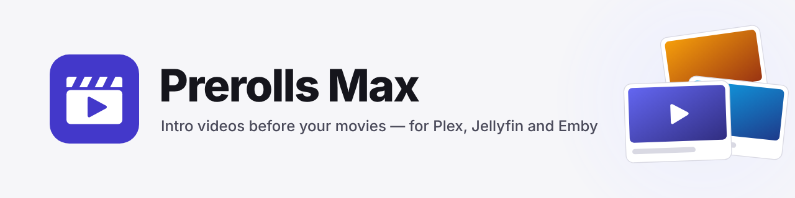
</picture>

<p align="center">
  <a href="https://github.com/modernharp/prerolls-max/releases"></a>
  <a href="https://github.com/modernharp/prerolls-max/actions/workflows/ci.yml"></a>
  <a href="LICENSE"></a>
  
</p>

# Prerolls Max

**Play a short intro video before your movies, the way a cinema does.** Prerolls Max works with Plex, Jellyfin and Emby. You pick the videos, and you decide when each one plays: a spooky intro all through October, a kids' intro before anything rated PG, a cinema-style pre-show on Friday nights. It runs on your own computer or NAS, and everything is set up in a web page.

> **Already use NeXroll?** Prerolls Max replaces it, and it can bring your NeXroll setup with it. See [Moving from NeXroll](#moving-from-nexroll).

> **Version 1.0.0.** What's new is in the [changelog](app/CHANGELOG.md). Found something odd? Please [tell us](https://github.com/modernharp/prerolls-max/issues/new/choose).

---

## Download

Pick the row that matches how you run your media server. Not sure? Most people on a Windows PC want the first row, and most people on a NAS or Linux box want Docker.

| I use... | Get this | Then |
|---|---|---|
| **Windows 10 or 11** | [**Windows installer (.exe)**](https://github.com/modernharp/prerolls-max/releases/download/v1.0.0/PrerollsMax_Installer_v1.0.0.exe) | Run it and follow the steps. [Details](#windows) |
| **Docker, a NAS, Synology, Linux** | [**docker-compose.yml**](https://raw.githubusercontent.com/modernharp/prerolls-max/main/docker-compose.yml) or the image `ghcr.io/modernharp/prerolls-max` | [Details](#docker) |
| **Unraid** | [**Unraid template**](https://modernharp.github.io/prerolls-max/unraid/prerolls-max.xml) | [Details](#unraid) |
| **Jellyfin** (a plugin, added after you install the app above) | Plugin repository: `https://modernharp.github.io/prerolls-max/jellyfin/manifest.json` | [Details](#jellyfin) |
| **Emby** (a plugin, added after you install the app above) | [**Emby plugin (.zip)**](https://github.com/modernharp/prerolls-max/releases/download/v1.0.0/PrerollsMax.Emby-2.1.0.1.zip) | [Details](#emby) |
| **Plex** | Nothing extra to download | [Details](#plex) |

Everything is also on the [**latest release page**](https://github.com/modernharp/prerolls-max/releases/latest), together with a `SHA256SUMS.txt` file if you like to check your downloads.


---

## What you get

- **Schedules.** Play a set of intros on certain dates, days of the week, holidays (including ones that move, like Easter), or times of day. A calendar shows what plays when, and which schedule wins if two overlap.
- **Rules** (Jellyfin and Emby). Different intros by genre, age rating, decade, library or who's watching. Kids-safe intros, a never-play list, and intros only before the first episode of a binge.
- **Free intros to download.** Browse [Prerolls.me](https://www.prerolls.me) and [Prerolls.uk](https://typicalnerds.uk) from inside the app. Every video is credited to the person who made it.
- **Fix your intros.** Even out the loudness so none is too quiet or too loud, make TV-friendly 1080p copies, and join several intros into one video for apps that only play the first.
- **Movie trailers** for upcoming films from Radarr, a **video maker** for your own intros, **watch folders** that add new videos by themselves, and a **What Played** page.
- **Help built in.** Step-by-step guides that work offline, a "my intro isn't playing" troubleshooter, and warnings when an app skips an intro.

What each media server can do differs a little. Plex plays intros before movies only, with one intro list for everyone. Jellyfin and Emby use a small Prerolls Max plugin and can pick a different intro for each play. Emby needs Emby Premiere.

## Screenshots

| | |
|---|---|
| [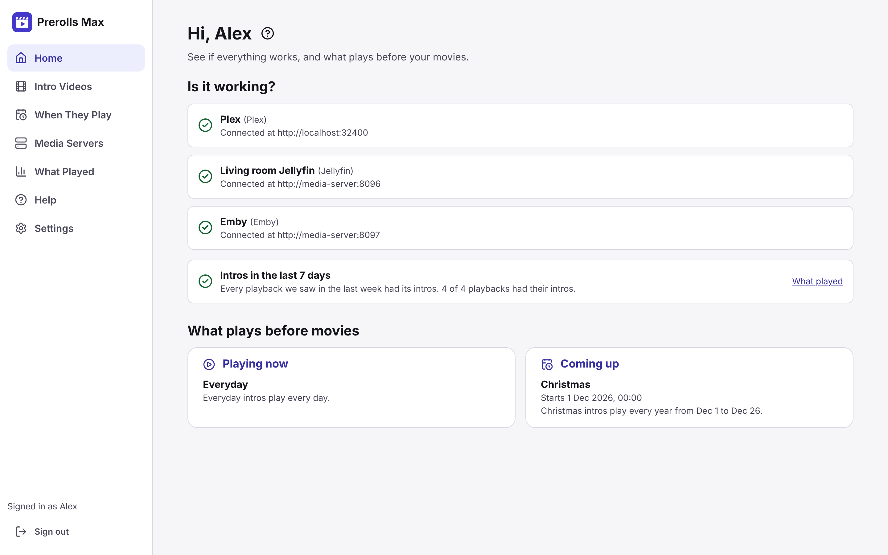](docs/images/home.png)<br>**Home:** is every server working, and what plays now and next. | [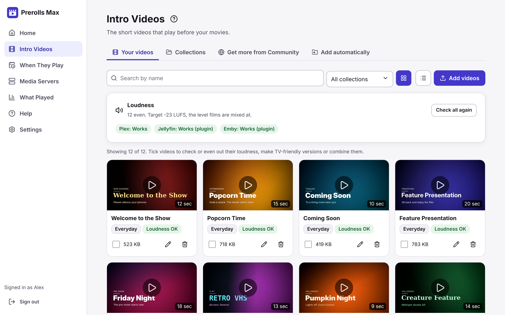](docs/images/intro-videos.png)<br>**Intro Videos:** your library, in collections, with even loudness. |
| [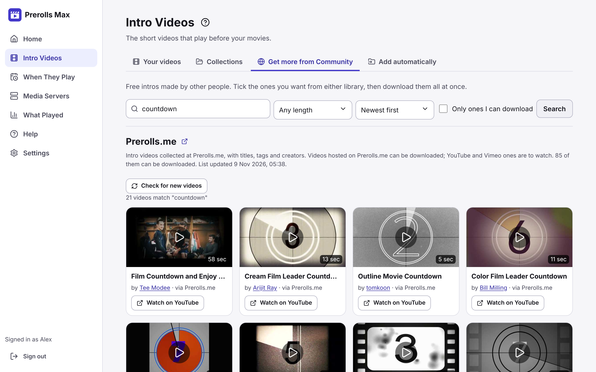](docs/images/community.png)<br>**Community:** free intros from Prerolls.me and Prerolls.uk, credited to their makers. | [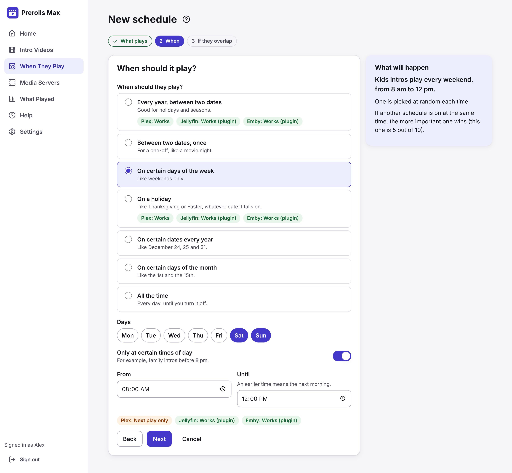](docs/images/schedule-wizard.png)<br>**New schedule:** three steps, with a sentence that says what will happen. |
| [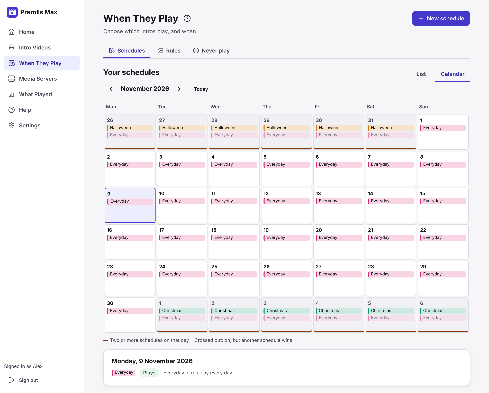](docs/images/calendar.png)<br>**Calendar:** which schedule plays on each day, and which one wins. | [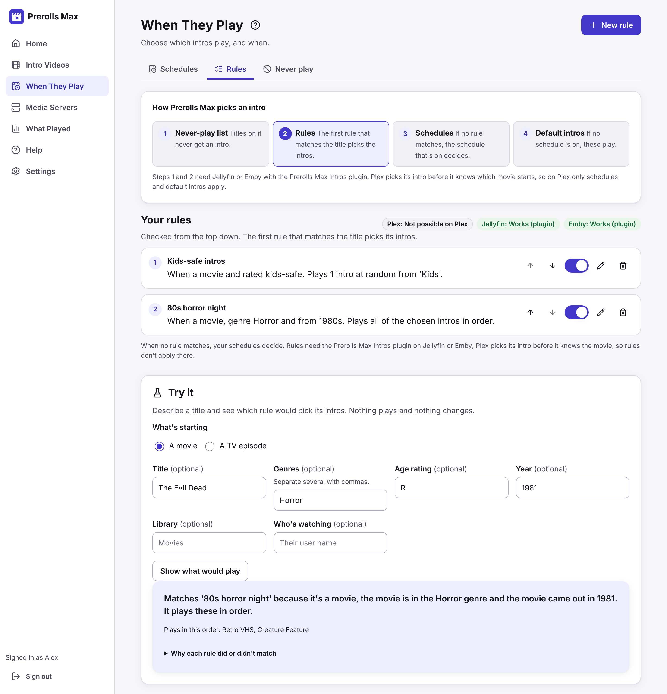](docs/images/rules.png)<br>**Rules:** kids-safe intros, an 80s horror night, and Try it to check a title. |
| [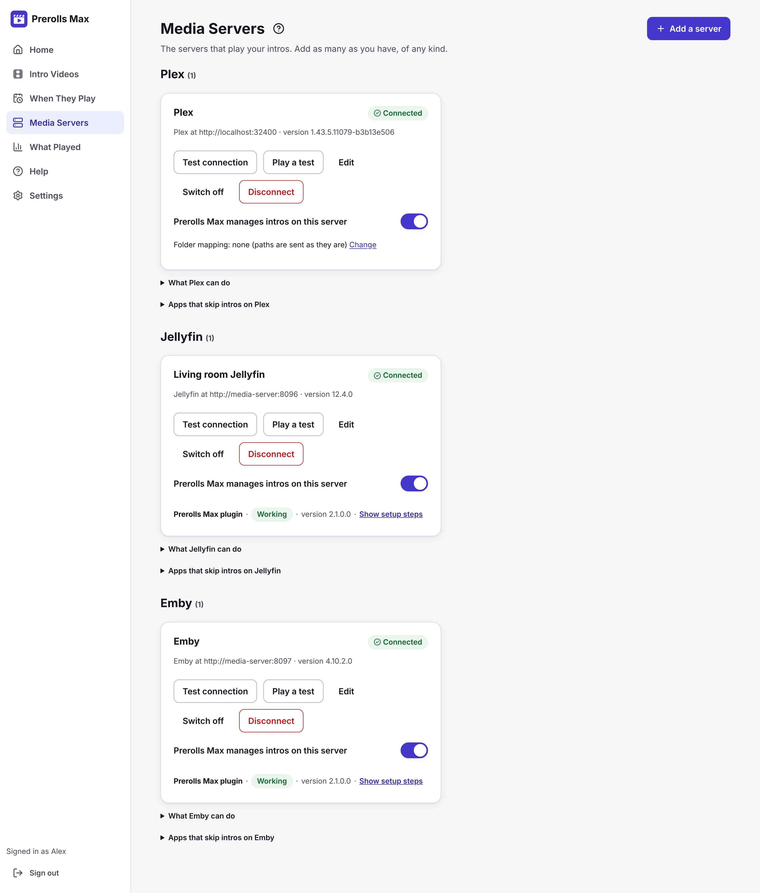](docs/images/media-servers.png)<br>**Media Servers:** Plex, Jellyfin and Emby side by side, with the plugin status. | [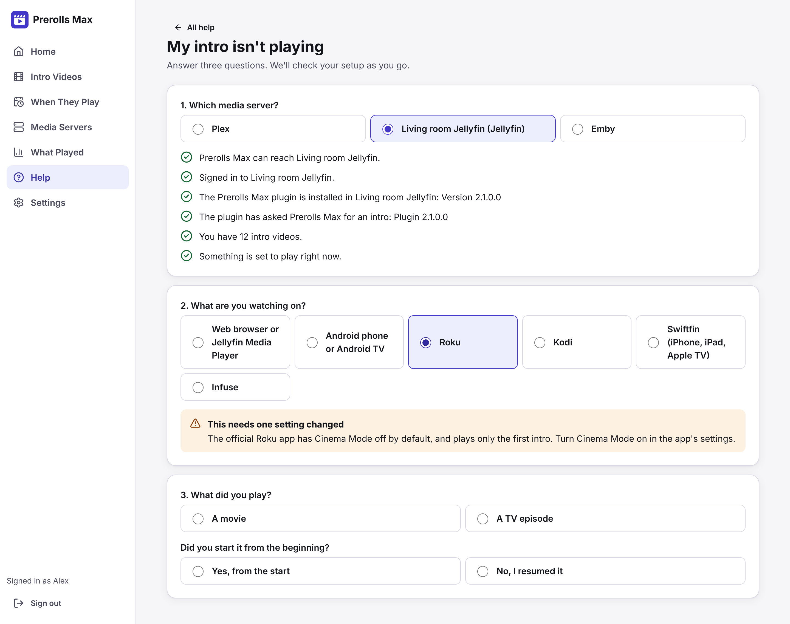](docs/images/help.png)<br>**Help:** the "my intro isn't playing" troubleshooter checks your setup as you answer. |
| [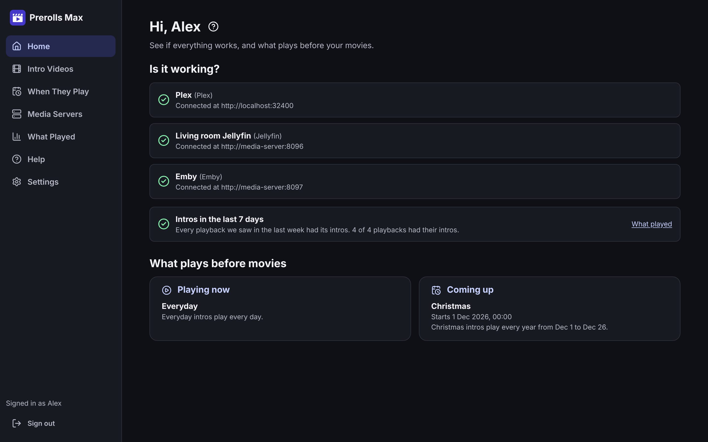](docs/images/dark-home.png)<br>**Dark mode** follows your system. | <a href="docs/images/phone.png">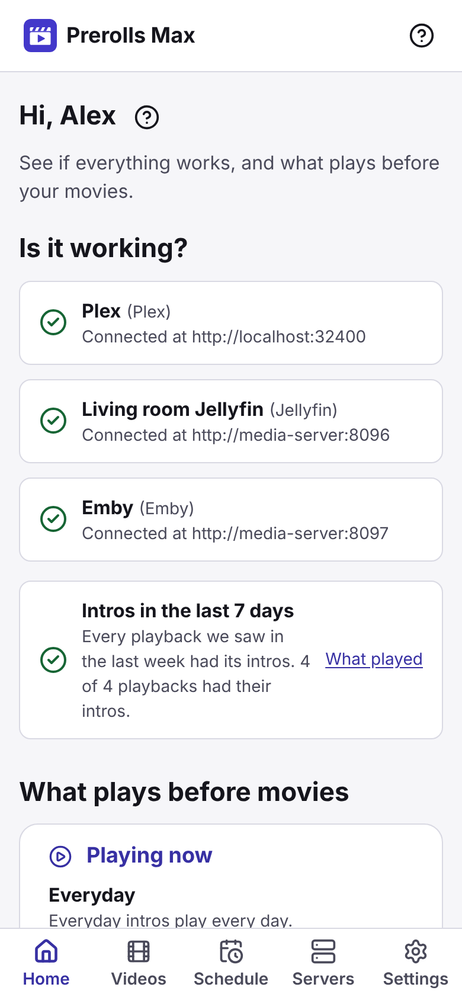</a><br>**On a phone:** the same app, with a tab bar at the bottom. |

---

## How to install

Prerolls Max is a small program that runs next to your media server and has a web page you use from any browser. It listens on port **9393**. Install it first; then, if you use Jellyfin or Emby, add the plugin for your server.

### Windows

1. [Download the installer](https://github.com/modernharp/prerolls-max/releases/download/v1.0.0/PrerollsMax_Installer_v1.0.0.exe) and run it.
2. It asks where to install and where to keep your intro videos. It can also install FFmpeg (needed to check and fix videos), run Prerolls Max as a Windows service that starts with Windows, and open port 9393 in the firewall.
3. Prerolls Max then has an icon in the system tray. Its data is in `C:\ProgramData\Prerolls Max`.

Windows may show a blue "Windows protected your PC" box because this early release isn't signed with a paid certificate. Choose **More info**, then **Run anyway**. If you'd rather check the file first, compare it with `SHA256SUMS.txt` on the release page.

Silent install for IT folk: `PrerollsMax_Installer_v1.0.0.exe /S`. Uninstall from **Settings > Apps**.

### Docker

You need Docker. The easiest way is the compose file:

1. Download [`docker-compose.yml`](https://raw.githubusercontent.com/modernharp/prerolls-max/main/docker-compose.yml) into a new folder.
2. Open it and change the line `/path/to/your/prerolls:/data/prerolls` so the left side is the folder on your computer where your intro videos live. Set your time zone too, so schedules start on time.
3. Run `docker compose up -d`.

Or in one line, without a file:

```bash
docker run -d --name prerollsmax --restart unless-stopped -p 9393:9393 \
  -e TZ=Europe/London -e PUID=1000 -e PGID=1000 \
  -v prerollsmax-data:/data \
  -v /path/to/your/prerolls:/data/prerolls \
  ghcr.io/modernharp/prerolls-max:latest
```

The image works on normal PCs and servers (amd64) and on Raspberry Pi and other ARM machines (arm64). It runs as an ordinary user, not as root. `PUID` and `PGID` should be the user and group that own your intro folder (run `id` to see yours; on Unraid they are 99 and 100).

If Plex runs in Docker too, give it the same intro folder, ideally at the same path inside both containers. If the paths differ, the app helps you set up a folder mapping; its Help article **Folder mapping** has a worked example.

### Unraid

1. In Unraid, open **Docker > Add Container**.
2. At **Template**, paste `https://modernharp.github.io/prerolls-max/unraid/prerolls-max.xml` and choose it.
3. Check the two folders (app data and your intro videos) and press **Apply**.

The defaults are port 9393, `/mnt/user/appdata/prerollsmax` for settings and `/mnt/user/media/prerolls` for your intros.


### From source

For developers and tinkerers. You need Python 3.12, Node.js 22 and FFmpeg.

```bash
python3 -m venv .venv
.venv/bin/pip install -r requirements.txt
cd frontend && npm ci && npm run build && cd ..
cd app && ../.venv/bin/uvicorn backend.main:app --port 9393
```

## First run

1. Open `http://<your-computer>:9393` in a browser, for example `http://192.168.1.10:9393`. On the same computer, `http://localhost:9393` works.
2. Make an account. This first account is the admin.
3. Follow the four steps on **Home**: connect your media server, add intro videos, choose when they play, and play a test.

Everything else is explained under **Help** in the app.

## Connect your media server

### Plex

Nothing to install. In Prerolls Max, open **Media Servers**, press **Connect Plex** and sign in with Plex. Prerolls Max fills in Plex's own intro setting for you.

### Jellyfin

Jellyfin needs the **Prerolls Max Intros** plugin.

1. In Jellyfin, open **Dashboard > Plugins > Repositories** and press **+**.
2. Name it `Prerolls Max` and use the address for your version:
   - Jellyfin 12: `https://modernharp.github.io/prerolls-max/jellyfin/manifest.json`
   - Jellyfin 10.11: `https://modernharp.github.io/prerolls-max/jellyfin/manifest-10.11.json`
3. Open **Catalog**, find **Prerolls Max Intros**, press **Install**, then restart Jellyfin.
4. In Prerolls Max, open **Media Servers**, connect Jellyfin, and press **Set up the plugin for me**.

### Emby

Emby plays intros only with Emby Premiere.

1. [Download the Emby plugin](https://github.com/modernharp/prerolls-max/releases/download/v1.0.0/PrerollsMax.Emby-2.1.0.1.zip) and unzip it.
2. Copy `PrerollsMax.Emby.dll` into Emby's `plugins` folder and restart Emby.
3. In Prerolls Max, open **Media Servers**, connect Emby, and press **Set up the plugin for me**.

The plugin's own page has more detail: [plugins/README.md](plugins/README.md).

---

## Moving from NeXroll

**Prerolls Max replaces NeXroll. Run one or the other, not both.** Plex has one intro list per server and both apps write to it, so they would keep overwriting each other. On Jellyfin and Emby each app has its own plugin, so with both installed every movie gets two sets of intros. Both also use port 9393.

Your NeXroll setup can come with you:

1. Back up NeXroll, then stop it. On Jellyfin or Emby, remove NeXroll's **NeXroll Intros** plugin.
2. Install Prerolls Max, then open **Settings > Moving from NeXroll**. It reads NeXroll's data folder, a NeXroll backup file, or a NeXroll that's still running, shows what it found, and lets you replace or merge.
3. With Docker, you can skip step 2: give Prerolls Max the same `/data` folder NeXroll used. On first start it copies `nexroll.db` and uses that. NeXroll's own file isn't changed, so you can go back.

The in-app Help article **Moving from NeXroll** ([source](frontend/src/help/moving-from-nexroll.md)) has every step for Windows, Docker and Unraid.

If you really want both for a while, you can: give Prerolls Max another port (`-p 9494:9393` in Docker, or choose it in the Windows installer) and pick which app manages each media server. The Help article explains how, and the risks.

Some things have new names: categories are now **collections**, filler is **default intros**, sequences are **playlists**, NeX-Up is **movie trailers**, and the generator is the **video maker**. Settings that start with `NEXROLL_` still work; the new names start with `PMAX_`.

---

## Get help

- **Inside the app:** open **Help**. It has step-by-step guides, a glossary, and a troubleshooter for "my intro isn't playing".
- **Longer explanations:** [rules](docs/features/rules.md), [TV and kids](docs/features/tv-and-kids.md), [how often and no repeats](docs/features/weights-and-cooldowns.md), [media tools](docs/features/media-tools.md), [watch folders](docs/features/watch-folders.md), [What Played](docs/features/play-history.md) and the [missed-intro check](docs/features/missed-intros.md).
- **Something broken, or an idea?** [Open an issue](https://github.com/modernharp/prerolls-max/issues/new/choose). The app's **Report a problem** page collects the details for you.

## What's in this repository

| Folder | What it is |
|---|---|
| `app/backend` | The server (Python, FastAPI) |
| `app/tests` | Automated tests, run on every push (`python -m pytest tests` from `app/`) |
| `frontend` | The web interface (Vite, React, TypeScript). Help articles are in `frontend/src/help` |
| `plugins` | The Jellyfin and Emby plugins. See [plugins/README.md](plugins/README.md) |
| `packaging/windows` | The Windows installer |
| `.github/workflows` | Builds and tests: CI, the Docker image, the Windows installer, the plugins, and releases |
| `scripts` | `bump_version.py` (one version everywhere), build info and release notes |
| `unraid` | The Unraid template, filled in for each release |
| `docs/features` | Longer explanations of individual features |

## Licence

Prerolls Max is released under the [**PolyForm Noncommercial License 1.0.0**](LICENSE). In plain words: you are free to use it, change it and share it for personal use, hobby projects, study, research, charities, schools and other **non-commercial** purposes. You may not use it to make money, for example by selling it or running it as a paid service. If you want to use it commercially, please get in touch through [Issues](https://github.com/modernharp/prerolls-max/issues). Only the licence text in [LICENSE](LICENSE) is legally binding; this paragraph is just a summary.

## Credits

Prerolls Max is built on [NeXroll](https://github.com/JFLXCLOUD/NeXroll) 2.4.0 by JFLXCLOUD, which was released under the MIT licence; that notice is kept in [LICENSE-NEXROLL-MIT](LICENSE-NEXROLL-MIT). Thank you to everyone who worked on it. Community intros come from [Prerolls.me](https://www.prerolls.me) and [Prerolls.uk by Typical Nerds](https://typicalnerds.uk), with each video credited to the person who made it. See [NOTICE.md](NOTICE.md).
